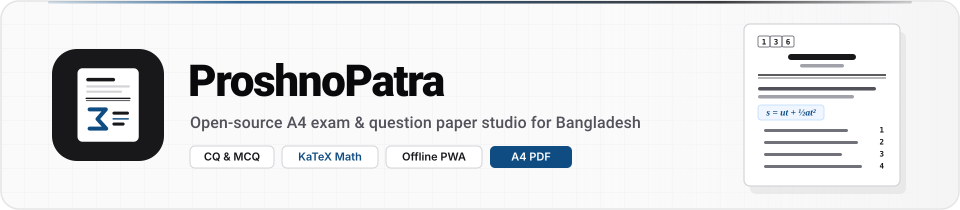
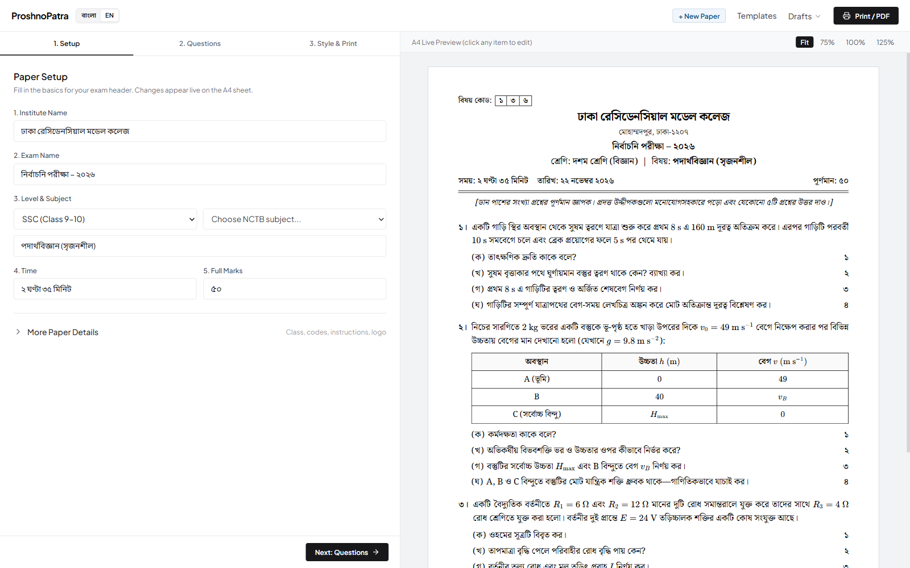
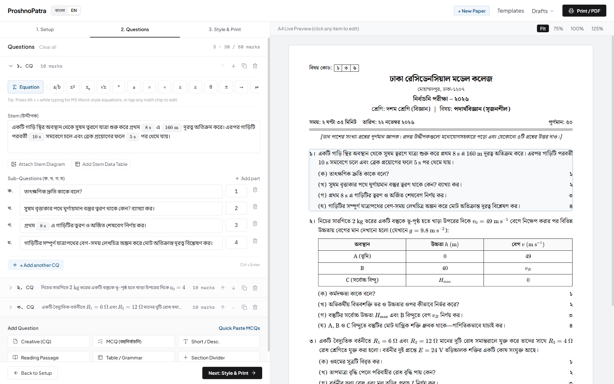
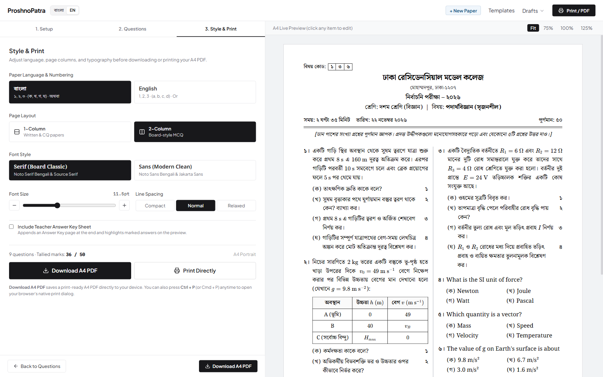
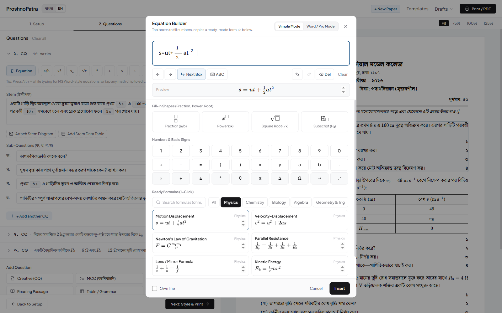
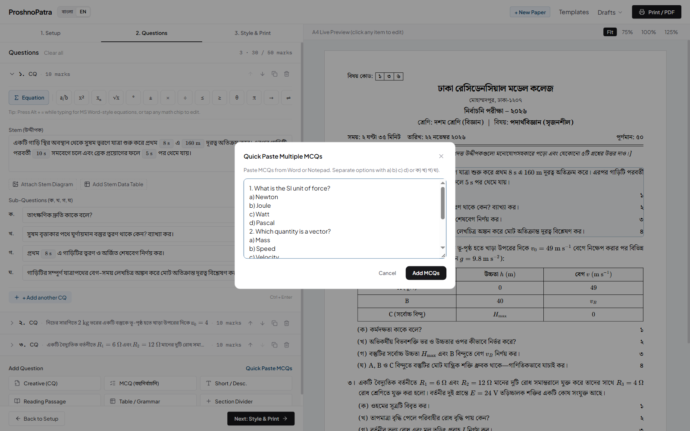
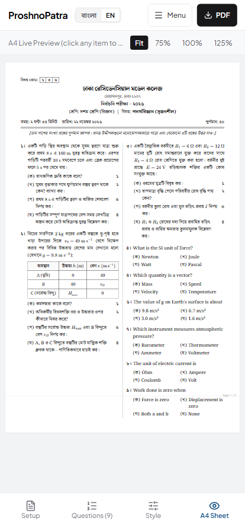
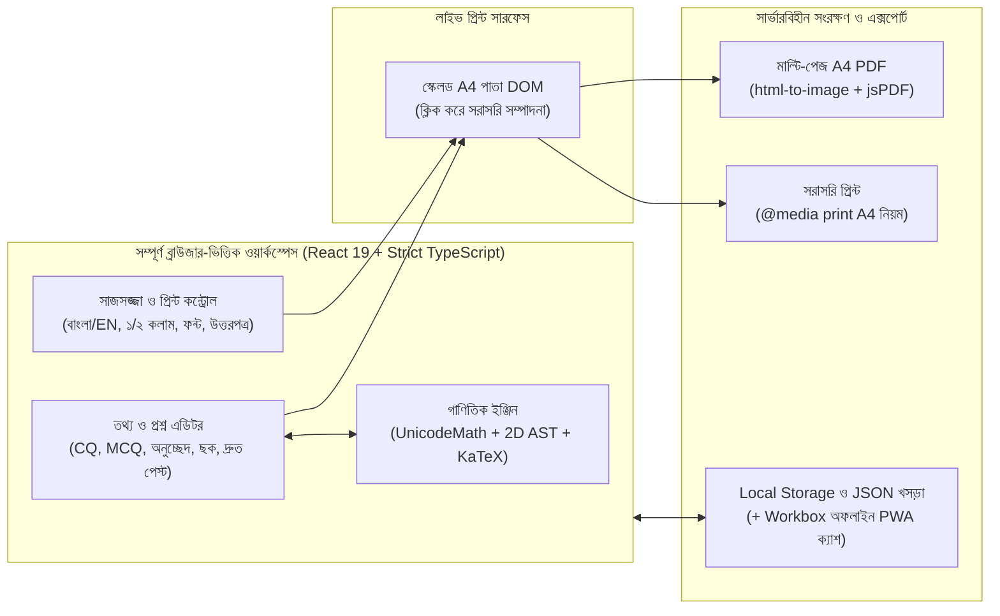

<div align="center">

<a href="https://aetheioai.github.io/ProshnoPatra-/">
  <picture>
    <source media="(prefers-color-scheme: dark)" srcset="docs/assets/banner-dark.svg" />
    <source media="(prefers-color-scheme: light)" srcset="docs/assets/banner-light.svg" />
    
  </picture>
</a>

<br />

<h3>প্রশ্নপত্র &middot; ProshnoPatra</h3>

<p>
  <b>বাংলাদেশের স্কুল, কলেজ ও বোর্ড পরীক্ষার A4 প্রশ্নপত্র তৈরির আধুনিক ওপেন-সোর্স অ্যাপ</b><br />
  <sub>সৃজনশীল (CQ) &middot; ২-কলাম বহুনির্বাচনি (MCQ) &middot; অনুচ্ছেদ ও ছক &middot; MS Word-স্টাইল গণিত সমীকরণ &middot; প্রিন্ট-রেডি A4 PDF</sub>
</p>

<p>
  <a href="README.md"><b>English (README.md)</b></a> &nbsp;&bull;&nbsp; <b>বাংলা (বর্তমান)</b>
</p>

<p>
  <a href="https://aetheioai.github.io/ProshnoPatra-/"></a>
  <a href="README.md"></a>
  <a href="CONTRIBUTING.md"></a>
</p>

<p>
  <a href="https://github.com/aetheioai/ProshnoPatra-/actions/workflows/ci.yml"></a>
  <a href="https://github.com/aetheioai/ProshnoPatra-/actions/workflows/deploy.yml"></a>
  <a href="LICENSE"></a>
  <a href="https://github.com/aetheioai/ProshnoPatra-/stargazers"></a>
  <a href="https://github.com/aetheioai/ProshnoPatra-/network/members"></a>
  <a href="https://github.com/aetheioai/ProshnoPatra-/issues"></a>
  <a href="#আর্কিটেকচার-ও-প্রযুক্তি"></a>
</p>

<p>
  <a href="#কেন-প্রশ্নপত্র-ব্যবহার-করবেন">কেন প্রশ্নপত্র?</a> &nbsp;&middot;&nbsp;
  <a href="#ফিচার-পরিচিতি">ফিচার পরিচিতি</a> &nbsp;&middot;&nbsp;
  <a href="#word-স্টাইল-সমীকরণ-ইঞ্জিন">সমীকরণ ইঞ্জিন</a> &nbsp;&middot;&nbsp;
  <a href="#nctb-পাঠ্যক্রম-ও-প্রশ্নের-ধরন">পাঠ্যক্রম ও ধরন</a> &nbsp;&middot;&nbsp;
  <a href="#কীবোর্ড-শর্টকাট">শর্টকাট</a> &nbsp;&middot;&nbsp;
  <a href="#লোকাল-সেটআপ-ও-ডেপ্লয়মেন্ট">লোকাল সেটআপ</a> &nbsp;&middot;&nbsp;
  <a href="#আর্কিটেকচার-ও-প্রযুক্তি">আর্কিটেকচার</a> &nbsp;&middot;&nbsp;
  <a href="#ওপেন-সোর্স-অবদান">অবদান রাখুন</a>
</p>

</div>

<br />

<p align="center">
  <a href="https://aetheioai.github.io/ProshnoPatra-/">
    
  </a>
  <br />
  <sub><b>বামপাশে লিখুন, ডানপাশের আসল A4 পাতায় সাথে সাথে প্রিভিউ দেখুন।</b><br />কোনো লগইন নেই, কোনো সার্ভার নেই, MS Word-এর মার্জিন ভাঙার ঝামেলা নেই — পর্দায় যা দেখবেন, প্রিন্টেও ঠিক তা-ই পাবেন।</sub>
</p>

> [!TIP]
> **শিক্ষকদের জন্য ঝামেলামুক্ত ব্যবহার:** যেকোনো আধুনিক ব্রাউজারে **[aetheioai.github.io/ProshnoPatra-](https://aetheioai.github.io/ProshnoPatra-/)** খুলে একটি NCTB টেমপ্লেট বেছে নিন এবং সাথে সাথে লেখা শুরু করুন। প্রথমবার লোড হওয়ার পর এটি **অফলাইন PWA** হিসেবে ইনস্টল করা যায় এবং ইন্টারনেট ছাড়াই সম্পূর্ণ কাজ করে।

---

## কেন প্রশ্নপত্র ব্যবহার করবেন?

সাধারণ ওয়ার্ড প্রসেসরে বাংলাদেশের বোর্ড-স্টাইল প্রশ্নপত্র বানাতে গেলে ২-কলাম সেটআপ, ডানপাশের নম্বর মেলানো, বাংলা নম্বর (<code>১, ২, ৩ / ক, খ, গ, ঘ</code>) এবং গণিত বা রসায়নের সমীকরণ ঠিক রাখতে ঘণ্টার পর ঘণ্টা সময় নষ্ট হয়। **প্রশ্নপত্র** তৈরি হয়েছে ১ম শ্রেণি থেকে এইচএসসি পর্যন্ত বাংলাদেশের প্রকৃত পরীক্ষার কাঠামো মাথায় রেখে।

<table>
  <tr>
    <td width="50%" valign="top">
      <h4>⚡ কোনো সেটআপ নেই, সম্পূর্ণ অফলাইন</h4>
      সরাসরি ব্রাউজারে চলে — ইনস্টলেবল PWA। কোনো অ্যাকাউন্ট, ব্যাকএন্ড সার্ভার বা API কী লাগে না; প্রথম ভিজিটের পর ইন্টারনেট ছাড়াই কাজ করে।
    </td>
    <td width="50%" valign="top">
      <h4>📄 আসল বোর্ড পরীক্ষার কাঠামো</h4>
      বিষয় কোডের ঘর (<code>১|৩|৬</code>), সেট কোড, প্রতিষ্ঠানের লোগো, সময় ও পূর্ণমান, ডাবল বর্ডার লাইন এবং ডানপাশে স্বয়ংক্রিয় নম্বর বিন্যাস।
    </td>
  </tr>
  <tr>
    <td width="50%" valign="top">
      <h4>🌐 সম্পূর্ণ দ্বিভাষিক (বাংলা ও English)</h4>
      অ্যাপের ইন্টারফেস এবং প্রশ্নপত্রের ভাষা আলাদাভাবে বাংলা বা ইংরেজিতে বদলানো যায় — <code>১, ২, ৩ / ক, খ, গ, ঘ</code> অথবা <code>1, 2, 3 / a, b, c, d</code>।
    </td>
    <td width="50%" valign="top">
      <h4>∑ LaTeX না শিখেই ছাপার মানের গণিত</h4>
      <kbd>Alt</kbd>+<kbd>=</kbd> চেপে MS Word-এর মতো <code>a/b</code>, <code>x^2</code>, <code>H_2O</code> লিখুন অথবা ১৫৫+ প্রস্তুত সূত্রসহ ভিজ্যুয়াল সমীকরণ বিল্ডার ব্যবহার করুন।
    </td>
  </tr>
  <tr>
    <td width="50%" valign="top">
      <h4>🖨️ এক ক্লিকেই প্রিন্ট-রেডি A4 PDF</h4>
      একাধিক পাতার ঝকঝকে A4 PDF ডাউনলোড করুন, অথবা কলেজের প্রিন্টার থেকে সরাসরি প্রিন্ট করুন নিখুঁত <code>@media print</code> স্টাইলশিটে।
    </td>
    <td width="50%" valign="top">
      <h4>🔒 শতভাগ গোপনীয়তা (লোকাল স্টোরেজ)</h4>
      আপনার তৈরি প্রশ্ন, লোগো, চিত্র ও খসড়া কেবল আপনার ডিভাইসের <code>localStorage</code>-এ সংরক্ষিত থাকে। চাইলে <code>.json</code> ফাইল হিসেবে ব্যাকআপ নিন।
    </td>
  </tr>
</table>

---

## ফিচার পরিচিতি

প্রশ্নপত্র সাজানো হয়েছে সহজ **৩ ধাপের কর্মপ্রবাহে** — **১. তথ্য ও শিরোনাম** → **২. প্রশ্ন যোগ** → **৩. সাজসজ্জা ও প্রিন্ট**। ডানপাশের লাইভ A4 পাতার যেকোনো প্রশ্নে ক্লিক করলেই সরাসরি তার এডিটরে চলে যাওয়া যায়।

### ১. বোর্ড-স্টাইল প্রশ্ন এডিটর ও ২-কলাম সাজসজ্জা

<table>
  <tr>
    <td width="50%" valign="top">
      <a href="docs/screenshots/02-questions.png">
        
      </a>
      <br />
      <b>গোছানো প্রশ্ন এডিটর</b><br />
      উদ্দীপক, চিত্র/ডায়াগ্রাম সংযুক্তি, উদ্দীপকের সারণি, কাস্টমাইজযোগ্য <code>ক–ঘ</code> উপ-প্রশ্ন, প্রতিটি অংশের নম্বর ও মোট নম্বরের লাইভ হিসাব একসাথে। <kbd>Ctrl</kbd>/<kbd>⌘</kbd>+<kbd>Enter</kbd> চাপলেই একই ধরনের পরবর্তী প্রশ্ন যোগ হয়ে যায়।
    </td>
    <td width="50%" valign="top">
      <a href="docs/screenshots/06-mcq-layout.png">
        
      </a>
      <br />
      <b>ফন্ট, কলাম এবং স্বয়ংক্রিয় উত্তরপত্র</b><br />
      সৃজনশীলের জন্য ১-কলাম বা বোর্ড-স্টাইল MCQ-এর জন্য ২-কলাম বেছে নিন। সেরিফ (বোর্ড ক্লাসিক) বা স্যান্স ফন্ট, অক্ষরের আকার, লাইনের ফাঁকা ঠিক করুন এবং এক ক্লিকেই শেষ পাতায় <b>শিক্ষকের MCQ উত্তরপত্র (Answer Key)</b> যুক্ত করুন।
    </td>
  </tr>
</table>

### ২. ভিজ্যুয়াল সমীকরণ বিল্ডার ও একসাথে অনেক MCQ পেস্ট

<table>
  <tr>
    <td width="50%" valign="top">
      <a href="docs/screenshots/03-equation-builder.png">
        
      </a>
      <br />
      <b>দ্বৈত-মোড সমীকরণ বিল্ডার</b><br />
      <b>সহজ মোডে</b> খালি ঘরে (ভগ্নাংশ, পাওয়ার, রুট, সাবস্ক্রিপ্ট) ট্যাপ করে সংখ্যা বসান বা বিষয়ভিত্তিক প্রস্তুত সূত্র (পদার্থবিজ্ঞান, রসায়ন, জীববিজ্ঞান, বীজগণিত, জ্যামিতি ও ত্রিকোণমিতি) বেছে নিন। <b>Word / প্রো মোডে</b> রয়েছে সম্পূর্ণ 2D AST স্ট্রাকচার, ম্যাট্রিক্স, পিসওয়াইজ কেস, আইসোটোপ ও সরাসরি LaTeX এডিটিং।
    </td>
    <td width="50%" valign="top">
      <a href="docs/screenshots/04-quick-paste.png">
        
      </a>
      <br />
      <b>দ্রুত MCQ পেস্ট (Bulk Importer)</b><br />
      MS Word, Google Docs বা নোটপ্যাডে আগে থেকেই MCQ লেখা আছে? <code>ক) খ) গ) ঘ)</code> বা <code>a) b) c) d)</code> ফরম্যাটের পুরো তালিকা একবারে পেস্ট করুন — প্রশ্নপত্র এক ক্লিকেই প্রতিটি প্রশ্ন আলাদা করে সাজিয়ে দেবে।
    </td>
  </tr>
</table>

### ৩. মোবাইল ও নেটওয়ার্কবিহীন শ্রেণিকক্ষের জন্য তৈরি PWA

<table>
  <tr>
    <td width="34%" align="center" valign="middle">
      <a href="docs/screenshots/07-mobile.png">
        
      </a>
    </td>
    <td width="66%" valign="middle">
      <h4>হাতের ফোন থেকেই প্রশ্ন তৈরি, যাচাই ও PDF</h4>
      <ul>
        <li><b>মোবাইল-বান্ধব ওয়ার্কস্পেস:</b> নিচের সহজ ট্যাবের মাধ্যমে <b>তথ্য</b>, <b>প্রশ্ন</b>, <b>সাজসজ্জা</b> এবং জুমযোগ্য <b>A4 পাতা</b> (<code>ফিট</code>, <code>75%</code>, <code>100%</code>, <code>125%</code>)-র মধ্যে দ্রুত যাতায়াত।</li>
        <li><b>টাচ-ফ্রেন্ডলি গণিত কীপ্যাড:</b> মোবাইলের সাধারণ কীবোর্ডে ঝামেলা না করেই ভগ্নাংশ, ঘাত, রাসায়নিক সংকেত ও গ্রিক চিহ্ন সহজে বসান।</li>
        <li><b>অফলাইন ইনস্টলেবল PWA:</b> Workbox সার্ভিস ওয়ার্কারের মাধ্যমে Android, iOS বা কম্পিউটারে অ্যাপ হিসেবে ইনস্টল করে ইন্টারনেট ছাড়াই ব্যবহার করুন।</li>
        <li><b>পোর্টেবল <code>.json</code> খসড়া:</b> ফোনে প্রশ্ন তৈরি করে <code>.json</code> এক্সপোর্ট করুন এবং পরে স্কুলের কম্পিউটারে ইমপোর্ট করে প্রিন্ট নিন।</li>
      </ul>
    </td>
  </tr>
</table>

---

## Word-স্টাইল সমীকরণ ইঞ্জিন

প্রশ্নপত্রে রয়েছে নিজস্ব **2D গাণিতিক AST ইঞ্জিন** (`src/utils/mathAst.ts`) এবং **UnicodeMath রূপান্তরকারী** (`src/utils/unicodeMath.ts`), যা **KaTeX**-এর মাধ্যমে ছাপার মানের সমীকরণ তৈরি করে।

| লেখার মাঝে টাইপ করে <kbd>Space</kbd> চাপুন | ফলাফল | ব্যবহারের ক্ষেত্র |
| :--- | :--- | :--- |
| `a/b` অথবা `(x+1)/(x-1)` | লব-হরের ভগ্নাংশ | বীজগণিত ও পদার্থবিজ্ঞানের অনুপাত |
| `x^2`, `v_0`, `m s^-2` | পাওয়ার ও সাবস্ক্রিপ্ট | গতিবিদ্যা ও SI একক |
| `H_2O`, `CO_2`, `H_2SO_4` | রাসায়নিক সংকেত | রসায়নের উদ্দীপক ও বিক্রিয়া |
| `\sqrt(b^2 - 4ac)` | বর্গমূল চিহ্ন | দ্বিঘাত সমীকরণ ও জ্যামিতি |
| `\theta`, `\pi`, `\Delta`, `\Omega` | $\theta, \pi, \Delta, \Omega$ | ত্রিকোণমিতি, পদার্থবিজ্ঞান ও বর্তনী |
| `->`, `<=>`, `>=`, `<=`, `+-` | $\rightarrow, \rightleftharpoons, \ge, \le, \pm$ | রাসায়নিক বিক্রিয়া ও অসমতা |
| `$E = mc^2$` | তাৎক্ষণিক ম্যাথ চিপ | সরাসরি LaTeX ব্যবহারকারীদের জন্য |

---

## NCTB পাঠ্যক্রম ও প্রশ্নের ধরন

প্রশ্নপত্রে **প্রাথমিক (১ম–৫ম)**, **নিম্ন মাধ্যমিক (৬ষ্ঠ–৮ম)**, **এসএসসি (৯ম–১০ম)**, **এইচএসসি (১১শ–১২শ)** এবং **কাস্টম / শ্রেণি অভীক্ষা**-র জন্য **২০টি NCTB বিষয়** স্বয়ংক্রিয় বিষয় কোডসহ যুক্ত রয়েছে।

### সমর্থিত প্রশ্নের ধরন

| প্রশ্নের ধরন | সুবিধাসমূহ |
| :--- | :--- |
| **সৃজনশীল (CQ)** | উদ্দীপক, চিত্র/ডায়াগ্রাম আপলোড (রিসাইজ ও অ্যালাইনমেন্টসহ), উদ্দীপকের ছক, `ক–ঘ` উপ-প্রশ্ন ও প্রতি অংশের নম্বর |
| **বহুনির্বাচনি (MCQ)** | ১ বা ২-কলাম লেআউট, অভিন্ন তথ্যভিত্তিক উদ্দীপক, বহুপদী সমাপ্তিসূচক (`i, ii, iii`) প্রশ্ন এবং শিক্ষকের উত্তরপত্র |
| **সংক্ষিপ্ত / বর্ণনামূলক** | প্রচলিত লিখিত প্রশ্ন, ঐচ্ছিক `অথবা / Or` বিকল্প প্রশ্ন এবং ডানপাশে নির্ধারিত নম্বর |
| **অনুচ্ছেদ (Reading Passage)** | দীর্ঘ অনুচ্ছেদের নিচে একাধিক বোধগম্যতা প্রশ্ন (ইংরেজি ১ম পত্র ও বাংলার জন্য উপযোগী) |
| **ছক / টেবিল ও গ্রামার** | হিসাববিজ্ঞানের রেওয়ামিল, বাম–ডান মিলকরণ (Column A–B), Substitution Table ও শূন্যস্থান পূরণের ক্লু-বক্স |
| **বিভাগ বিভাজক (Section Divider)** | পুরো পাতাজুড়ে বিভাগের শিরোনাম (`ক-বিভাগ`, `Part A: Reading Test`) এবং বিশেষ নির্দেশনা |

### প্রস্তুত স্টার্টার টেমপ্লেটসমূহ (১ ক্লিকে শুরু)

1. **এসএসসি পদার্থবিজ্ঞান (সৃজনশীল · বাংলা)** — দশম শ্রেণি, বিষয় কোড `১৩৬`, গাণিতিক সমীকরণ, উদ্দীপকের সারণি ও `১-২-৩-৪` নম্বর
2. **এইচএসসি রসায়ন (২-কলাম MCQ · বাংলা)** — দ্বাদশ শ্রেণি, কোড `১৭৬`, ২-কলাম বোর্ড ফরম্যাট, বহুপদী (`i, ii, iii`) ও রাসায়নিক সমীকরণ
3. **এসএসসি ইংরেজি ১ম পত্র (English)** — ৯ম–১০ম শ্রেণি, কোড `107`, রিডিং প্যাসেজ, ক্লুসহ শূন্যস্থান ও সাবস্টিটিউশন টেবিল
4. **এইচএসসি হিসাববিজ্ঞান (রেওয়ামিল সৃজনশীল · বাংলা)** — ১১শ–১২শ শ্রেণি, কোড `২৫৩`, ডান-অ্যালাইনড টাকার অঙ্কসহ আর্থিক বিবরণীর ছক
5. **প্রাথমিক ৫ম শ্রেণি (গণিত ও মিলকরণ · বাংলা)** — ৫ম শ্রেণি, বাম–ডান মিলকরণ ছক, সংক্ষিপ্ত গণিত ও `অথবা`-সহ বর্ণনামূলক প্রশ্ন

---

## কীবোর্ড শর্টকাট

| শর্টকাট | কাজ |
| :--- | :--- |
| <kbd>Alt</kbd> + <kbd>=</kbd> | কার্সরের স্থানে MS Word-এর মতো ইনলাইন সমীকরণ বক্স খোলা |
| <kbd>Space</kbd> *(লেখার ঘরে)* | আগের লিনিয়ার গণিত (`a/b`, `x^2`, `H_2`, `\theta`, `>=`)-কে KaTeX চিপে রূপান্তর করা |
| <kbd>Ctrl</kbd>/<kbd>⌘</kbd> + <kbd>=</kbd> | ইনলাইন সমীকরণ বক্সে রেন্ডার করা প্রিভিউ দেখা |
| <kbd>Ctrl</kbd>/<kbd>⌘</kbd> + <kbd>Shift</kbd> + <kbd>=</kbd> | সমীকরণ বক্সকে পুনরায় লিনিয়ার টেক্সটে ফিরিয়ে আনা |
| <kbd>Enter</kbd> / <kbd>Esc</kbd> | ইনলাইন সমীকরণ যুক্ত করা / বাতিল করা |
| <kbd>Ctrl</kbd>/<kbd>⌘</kbd> + <kbd>Enter</kbd> | একই ধরনের আরেকটি নতুন প্রশ্ন যোগ করে লেখা চালিয়ে যাওয়া |
| <kbd>Ctrl</kbd>/<kbd>⌘</kbd> + <kbd>P</kbd> | A4 পাতার জন্য প্রস্তুত ব্রাউজারের প্রিন্ট ডায়ালগ খোলা |

---

## লোকাল সেটআপ ও ডেপ্লয়মেন্ট

### প্রয়োজনীয়তা

- **Node.js 20+** (Node 22 LTS প্রস্তাবিত)
- **npm**, **bun**, অথবা **pnpm**

### কম্পিউটারে চালানোর নিয়ম

```bash
# ১. রিপোজিটরি ক্লোন করুন
git clone https://github.com/aetheioai/ProshnoPatra-.git
cd ProshnoPatra-

# ২. ডিপেন্ডেন্সি ইনস্টল করুন
npm install          # অথবা: bun install

# ৩. লোকাল ডেভ সার্ভার চালু করুন
npm run dev          # চালু হবে http://localhost:3000 ঠিকানায়
```

কোনো `.env` ফাইল, ডেটাবেস বা API কী-এর প্রয়োজন নেই।

### গুরুত্বপূর্ণ স্ক্রিপ্টসমূহ

| কমান্ড | কাজ |
| :--- | :--- |
| `npm run dev` | `http://localhost:3000`-এ লোকাল ডেভ সার্ভার চালু করা |
| `npm run build` | `dist/` ফোল্ডারে প্রোডাকশন বান্ডেল ও PWA সার্ভিস ওয়ার্কার তৈরি করা |
| `npm run preview` | প্রোডাকশন বিল্ড লোকালি প্রিভিউ করা |
| `npm run typecheck` | স্ট্রিক্ট TypeScript টাইপ চেক (`tsc --noEmit`) চালানো |
| `npm run clean` | `dist/` এবং `dev-dist/` ফোল্ডার পরিষ্কার করা |

### হোস্টিং ও ডেপ্লয়মেন্ট

- **GitHub Pages (আগে থেকেই কনফিগার করা):** `main` ব্রাঞ্চে পুশ করলেই [`.github/workflows/deploy.yml`](.github/workflows/deploy.yml) স্বয়ংক্রিয়ভাবে টাইপচেক, বিল্ড (`VITE_BASE_PATH`), `404.html` ও `.nojekyll` তৈরি করে ডেপ্লয় করে। নিজের ফর্কে চালাতে **Settings → Pages → Source: GitHub Actions** চালু করুন।
- **Cloudflare Pages / Vercel / Netlify:** `npm run build` চালিয়ে `dist/` ফোল্ডার প্রকাশ করলেই চলবে (`VITE_BASE_PATH` ডিফল্টভাবে `/`)।

---

## আর্কিটেকচার ও প্রযুক্তি



### ব্যবহৃত প্রযুক্তি

| স্তর | প্রযুক্তি | ভূমিকা |
| :--- | :--- | :--- |
| **মূল ফ্রেমওয়ার্ক** | React 19 + TypeScript (`strict`) | মডুলার ওয়ার্কস্পেস ও টাইপ-সেফ প্রশ্নপত্র মডেল |
| **বিল্ড টুল** | Vite 8 | দ্রুত ডেভেলপমেন্ট সার্ভার ও হালকা প্রোডাকশন বান্ডেল |
| **স্টাইলিং** | Tailwind CSS v4 | আধুনিক ইন্টারফেস এবং A4 `@media print` স্টাইলশিট |
| **সমীকরণ রেন্ডারিং** | KaTeX + নিজস্ব 2D AST / UnicodeMath | LaTeX না জেনেই ছাপার মানের গাণিতিক চিহ্ন |
| **PDF তৈরি** | `html-to-image` + `jsPDF` | ব্রাউজারেই একাধিক পাতার A4 PDF এক্সপোর্ট |
| **অফলাইন / PWA** | `vite-plugin-pwa` (Workbox) | ইনস্টলেবল অ্যাপ ও অফলাইন ক্যাশিং |
| **আইকন** | `lucide-react` | পরিচ্ছন্ন ভেক্টর আইকন |

<details>
<summary><b>প্রজেক্টের সম্পূর্ণ ফোল্ডার কাঠামো দেখুন</b></summary>

```text
ProshnoPatra-/
├── .github/
│   ├── ISSUE_TEMPLATE/              # বাগ রিপোর্ট ও ফিচার অনুরোধের টেমপ্লেট
│   └── workflows/
│       ├── ci.yml                   # প্রতিটি পুশ ও PR-এ টাইপচেক ও বিল্ড যাচাই
│       └── deploy.yml               # স্বয়ংক্রিয় GitHub Pages ডেপ্লয়মেন্ট
├── docs/
│   ├── assets/                      # লাইট/ডার্ক মোড SVG ব্যানার
│   └── screenshots/                 # ডকুমেন্টেশনের স্ক্রিনশট
├── public/                          # অ্যাপ আইকন ও PWA অ্যাসেট
├── src/
│   ├── components/
│   │   ├── HeaderEditor.tsx         # ধাপ ১: প্রতিষ্ঠান, পরীক্ষা, NCTB বিষয় ও লোগো
│   │   ├── QuestionEditors.tsx      # ধাপ ২: CQ, MCQ, সংক্ষিপ্ত, অনুচ্ছেদ, ছক ও বিভাগ এডিটর
│   │   ├── StylePrintStep.tsx       # ধাপ ৩: ভাষা, কলাম, ফন্ট ও PDF/প্রিন্ট
│   │   ├── PaperPreview.tsx         # লাইভ স্কেলড A4 পাতা ও প্রিন্ট সারফেস
│   │   ├── VisualMathModal.tsx      # 2D AST সমীকরণ বিল্ডার (সহজ ও প্রো মোড)
│   │   ├── VisualRichInput.tsx      # KaTeX চিপ ও Word-স্টাইল গণিতসহ ইনপুট
│   │   ├── InlineEquationPill.tsx   # Alt+= ইনলাইন সমীকরণ পিল ও শর্টকাট
│   │   ├── RichMathText.tsx         # A4 পাতায় সাধারণ লেখা ও LaTeX রেন্ডারার
│   │   ├── TableGridEditor.tsx      # স্প্রেডশিট-স্টাইল ছক/টেবিল এডিটর
│   │   ├── ImageAttachmentControl.tsx # লোকাল চিত্র আপলোড, রিসাইজ ও অ্যালাইনমেন্ট
│   │   ├── TemplateLibraryModal.tsx # নতুন ফাঁকা পাতা, টেমপ্লেট ও সংরক্ষিত খসড়া
│   │   └── PWAInstallButton.tsx     # ইনস্টল বাটন ও অফলাইন ব্যানার
│   ├── data/
│   │   ├── curriculum.ts            # ২০টি NCTB বিষয় (১ম–HSC) ও ৫টি স্টার্টার টেমপ্লেট
│   │   ├── mathLibrary.ts           # ১৫৫+ গাণিতিক চিহ্ন ও বিষয়ভিত্তিক প্রস্তুত সূত্র
│   │   └── uiCopy.ts                # সম্পূর্ণ দ্বিভাষিক (বাংলা / English) ইন্টারফেস টেক্সট
│   ├── hooks/
│   │   └── usePWAInstall.ts         # PWA ইনস্টল ও অনলাইন/অফলাইন হুক
│   ├── types/
│   │   └── paper.ts                 # ExamPaper ও QuestionItem টাইপ ডেফিনিশন
│   ├── utils/
│   │   ├── bulkMcqParser.ts         # বাংলা ও ইংরেজি দ্রুত MCQ পার্সার
│   │   ├── formatters.ts            # বাংলা সংখ্যা রূপান্তর, নম্বর গণনা ও JSON যাচাই
│   │   ├── mathAst.ts               # দ্বিমুখী LaTeX ⇄ 2D ভিজ্যুয়াল AST ইঞ্জিন
│   │   ├── unicodeMath.ts           # MS Word-স্টাইল UnicodeMath কনভার্টার
│   │   └── pdfExport.ts             # মাল্টি-পেজ A4 PDF জেনারেটর ও প্রিন্ট ফলব্যাক
│   ├── App.tsx                      # মূল ওয়ার্কস্পেস ও localStorage সংরক্ষণ
│   ├── index.css                    # Tailwind থিম, বাংলা/ইংরেজি ফন্ট ও প্রিন্ট স্টাইল
│   └── main.tsx                     # এন্ট্রি পয়েন্ট ও সার্ভিস ওয়ার্কার রেজিস্ট্রেশন
├── README.md                        # ইংরেজি ডকুমেন্টেশন
├── README.bn.md                     # বাংলা ডকুমেন্টেশন
├── CONTRIBUTING.md                  # অবদান রাখার নির্দেশিকা
├── CODE_OF_CONDUCT.md               # কমিউনিটি আচরণবিধি
├── SECURITY.md                      # নিরাপত্তা নীতিমালা
└── LICENSE                          # MIT লাইসেন্স
```

</details>

---

## গোপনীয়তা ও অফলাইন সংরক্ষণ

> [!NOTE]
> **শতভাগ ক্লায়েন্ট-সাইড সুরক্ষা:** প্রশ্নপত্র আপনার কোনো প্রশ্ন, প্রতিষ্ঠানের লোগো, ডায়াগ্রাম বা খসড়া কোনো বহিরাগত সার্ভারে পাঠায় না। সবকিছু আপনার নিজস্ব ব্রাউজারের `localStorage`-এ সংরক্ষিত থাকে এবং এতে কোনো অ্যানালিটিক্স বা ট্র্যাকার নেই।

---

## ওপেন-সোর্স অবদান

শিক্ষক, শিক্ষার্থী, ডিজাইনার ও ডেভেলপার — সবার অবদানই আন্তরিকভাবে স্বাগত! বাংলা প্রিন্ট লেআউটের সূক্ষ্ম উন্নতি হোক কিংবা নতুন পাঠ্যক্রম টেমপ্লেট যোগ করা — আপনার প্রতিটি Pull Request সারা দেশের শিক্ষাপ্রতিষ্ঠানগুলোর উপকারে আসবে।

### কোথায় অবদান রাখতে পারেন?

- **NCTB পাঠ্যক্রম ও টেমপ্লেট** (`src/data/curriculum.ts`) — মাদ্রাসা (দাখিল/আলিম), ইংরেজি ভার্সন বা নতুন শ্রেণির প্রস্তুত টেমপ্লেট যোগ করা।
- **গণিত ও বিজ্ঞান লাইব্রেরি** (`src/data/mathLibrary.ts`, `src/utils/mathAst.ts`) — রসায়নের নতুন প্রতীক, উচ্চতর গণিতের কাঠামো বা AST পার্সিং উন্নত করা।
- **প্রিন্ট ও বোর্ড টাইপোগ্রাফি** (`src/components/PaperPreview.tsx`, `src/index.css`) — A4 পেজ-ব্রেক, বাংলা ফন্টের ভারসাম্য ও ২-কলাম MCQ লেআউট আরও নিখুঁত করা।
- **বাংলা ভাষা ও অ্যাক্সেসিবিলিটি** (`src/data/uiCopy.ts`) — বাংলা অনুবাদ আরও প্রাঞ্জল করা, কীবোর্ড নেভিগেশন ও মোবাইল অভিজ্ঞতা উন্নত করা।

### কমিউনিটি লিংকসমূহ

| রিসোর্স | লিংক |
| :--- | :--- |
| **অবদান নির্দেশিকা** | [CONTRIBUTING.md](CONTRIBUTING.md) |
| **বাগ রিপোর্ট করুন** | [নতুন বাগ রিপোর্ট খুলুন](https://github.com/aetheioai/ProshnoPatra-/issues/new?template=bug_report.md) |
| **নতুন ফিচারের পরামর্শ** | [ফিচার অনুরোধ পাঠান](https://github.com/aetheioai/ProshnoPatra-/issues/new?template=feature_request.md) |
| **আচরণবিধি** | [CODE_OF_CONDUCT.md](CODE_OF_CONDUCT.md) |
| **নিরাপত্তা নীতিমালা** | [SECURITY.md](SECURITY.md) |

---

## লাইসেন্স

প্রজেক্টটি **[MIT লাইসেন্স](LICENSE)**-এর অধীনে সম্পূর্ণ উন্মুক্ত — আপনার স্কুল, কলেজ বা কোচিং সেন্টারে বিনামূল্যে ব্যবহার, পরিবর্তন ও নিজের সার্ভারে হোস্ট করতে পারবেন।

<br />

<div align="center">

### শিক্ষকদের জন্য তৈরি — যেন ফরম্যাটিংয়ের বদলে পাঠদানেই মন দেওয়া যায়।

**প্রশ্নপত্র** যদি আপনার প্রশ্ন তৈরির মূল্যবান সময় বাঁচিয়ে থাকে,<br />
⭐ **[রিপোজিটরিতে একটি স্টার (Star) দিন](https://github.com/aetheioai/ProshnoPatra-)** — যাতে আরও শিক্ষক ও ডেভেলপার এটি খুঁজে পান!

<p>
  <a href="https://aetheioai.github.io/ProshnoPatra-/">লাইভ অ্যাপ</a> &nbsp;&middot;&nbsp;
  <a href="README.md">English Version</a> &nbsp;&middot;&nbsp;
  <a href="CONTRIBUTING.md">অবদান রাখুন</a> &nbsp;&middot;&nbsp;
  <a href="LICENSE">MIT লাইসেন্স</a>
</p>

</div>
