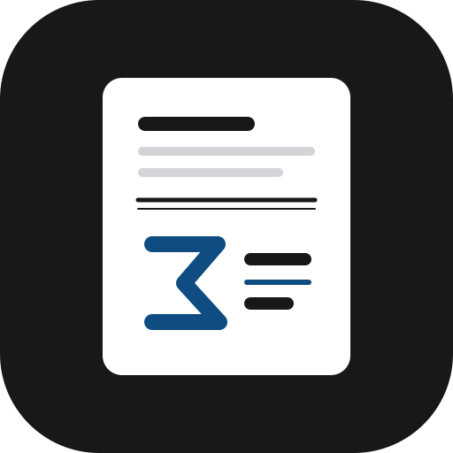
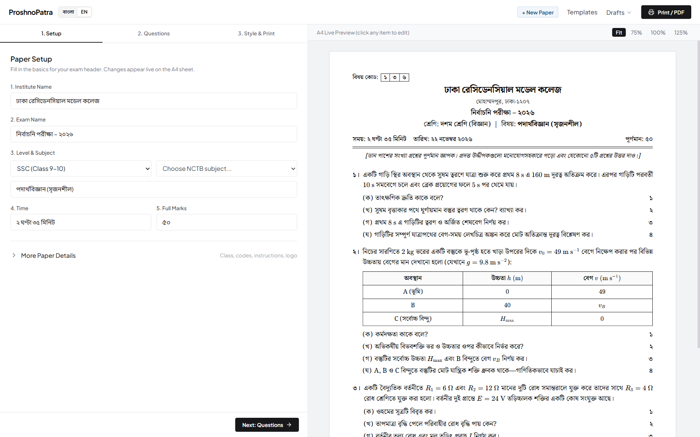
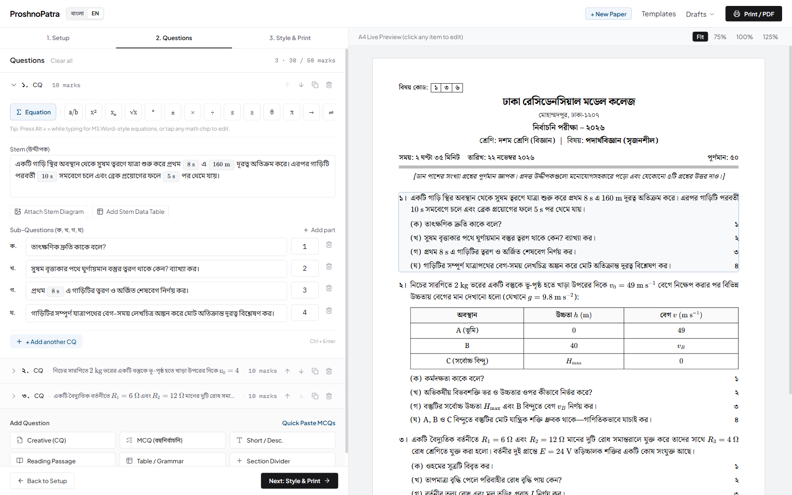
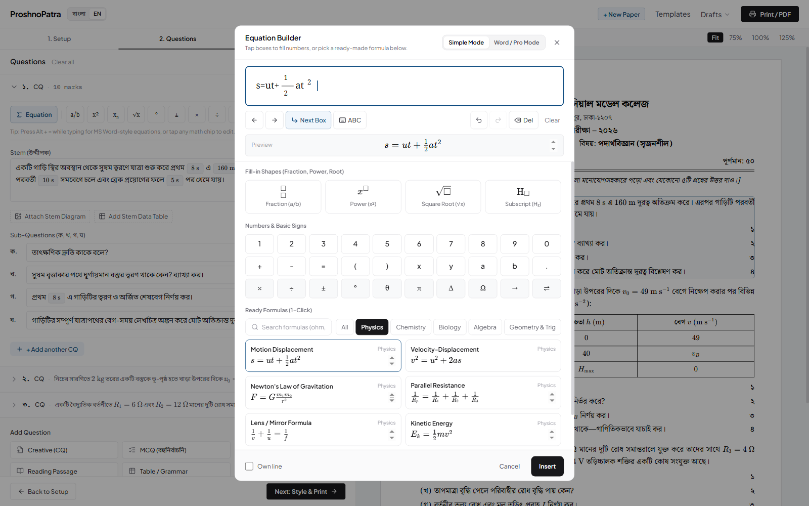
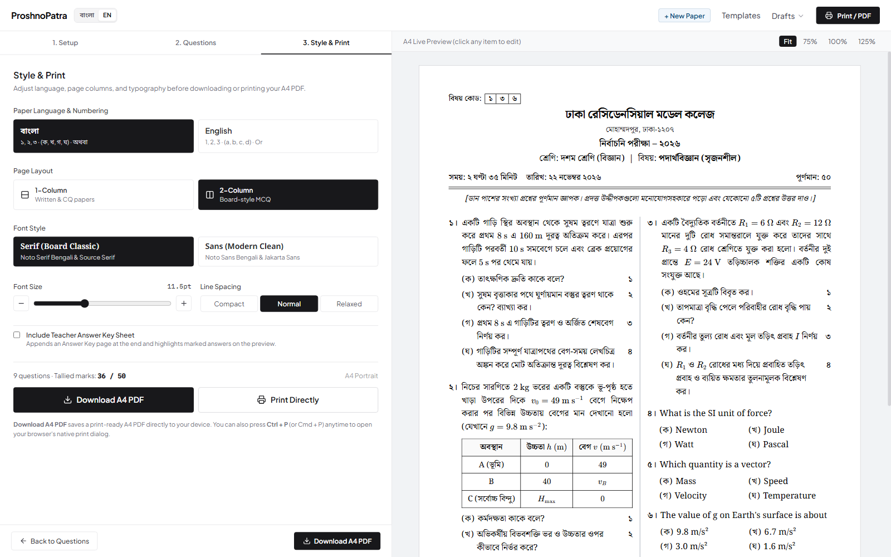

<div align="center">
<p></p>
<h1>ProshnoPatra</h1>
<h3>Exam &amp; question paper maker for Bangladeshi schools, colleges and board exams</h3>
<p><b>CQ &middot; 2-column MCQ &middot; reading passages &middot; tables &middot; Word-style math &middot; print-ready A4 PDF</b></p>
<p>Runs entirely in the browser — offline-first PWA, no backend, no accounts, no API keys.</p>
<p>
<a href="https://github.com/aetheioai/ProshnoPatra-/actions/workflows/ci.yml"></a>
<a href="https://github.com/aetheioai/ProshnoPatra-/actions/workflows/deploy.yml"></a>
<a href="LICENSE"></a>
<a href="#tech-stack"></a>
<a href="#tech-stack"></a>
<a href="#tech-stack"></a>
<a href="#tech-stack"></a>
</p>
<p><a href="https://aetheioai.github.io/ProshnoPatra-/"><b>Open the live app →</b></a> &nbsp;&middot;&nbsp; <a href="https://github.com/aetheioai/ProshnoPatra-/issues">Report a bug</a> &nbsp;&middot;&nbsp; <a href="CONTRIBUTING.md">Contribute</a></p>
</div>

<p align="center">
  <a href="https://aetheioai.github.io/ProshnoPatra-/">
    
  </a>
  <br />
  <sub><b>Edit on the left, watch the real A4 page update on the right.</b><br />No “generate” button, no page reloads — the sheet you see is the sheet you print.</sub>
</p>

---

## Why teachers use it

| Benefit | What you get |
| :-- | :-- |
| **⚡ Nothing to set up** | Open the link, start typing. No install, no login, no internet after the first visit. |
| **📄 Real board format** | Subject code boxes, set codes, institute logo, time/marks header, hairline rules — not a generic text editor. |
| **🔢 Bangla or English** | Interface in বাংলা or English; numbering in `১, ২, ৩ / ক, খ, গ, ঘ` or `1, 2, 3 / a, b, c, d`. |
| **∑ Math that looks printed** | Fractions, roots, powers, matrices, isotopes and reaction arrows rendered with KaTeX. |
| **🖨️ One-click A4 PDF** | Multi-page vector-quality PDF, or the native print dialog if you prefer your college printer. |
| **🔒 Your paper stays yours** | Everything lives in `localStorage` on your own device. Nothing is uploaded anywhere. |

---

## Feature tour

### 1. Paper setup & authentic board header

Pick the class level (Class 1 → HSC), the NCTB subject, and the paper is pre-filled with the right codes, marks and format hints. The header supports institute name, address, exam title, set code, subject code, date, time, full marks and an institute logo.

### 2. Question editors built around real exam formats

- **Creative Questions (CQ / সৃজনশীল)** — stem text, attached diagrams, stem data tables, and customizable `ক–ঘ` sub-questions with per-part marks.
- **Multiple Choice (MCQ / বহুনির্বাচনি)** — 1- or 2-column layouts, common stems, multi-statement (`i, ii, iii`) format, and an optional teacher answer key sheet.
- **Short & descriptive**, **reading passages** with comprehension parts, **tables & grammar blocks** (trial balances, Column A–B matching, gap-fill with clues) and full-width **section dividers**.
- **Fast authoring** — `Ctrl/Cmd + Enter` adds another question of the same type; click any question in the preview to jump straight to its editor.

<p align="center">
  
  <br />
  <sub><b>Question editor</b> — sub-questions, per-part marks, live totals and one-tap math chips, side by side with the board-formatted sheet.</sub>
</p>

### 3. Word-style equations, without learning LaTeX

Two ways to write math that survives printing:

- **Type it inline.** Press <kbd>Alt</kbd> + <kbd>=</kbd> in any field and type `a/b`, `x^2`, `H_2`, `\sqrt(x)`, `\theta`, `>=` or `->` — the spacebar converts it to a typeset chip in place. A closing `$...$` does the same.
- **Open the builder.** A point-and-click AST editor with **Simple Mode** (touch-friendly fill-in fraction/power/root/subscript shapes, a number keypad and ready NCTB formulas for Physics, Chemistry, Biology, Maths, Algebra, Geometry & Trig — the category follows your paper subject) and **Word / Pro Mode** (full structure tree, symbol palettes, matrices, piecewise cases, nuclear isotopes, raw LaTeX).

<p align="center">
  
  <br />
  <sub><b>Simple Mode</b> — tap a shape or a ready formula; the live preview confirms it before it lands in the paper.</sub>
</p>

### 4. Paste a whole MCQ set at once

Got questions in Word or Notepad? Drop them in and ProshnoPatra splits every `1. Question` + `a) b) c) d)` (or `ক) খ) গ) ঘ)`) block into individual MCQs.

<p align="center">
  
  <br />
  <sub><b>Quick Paste MCQs</b> — a full question set becomes editable items in one click.</sub>
</p>

### 5. Style, paginate, print

Language, 1-column vs 2-column layout, serif “board classic” or modern sans typography, font size, line spacing, and the optional answer key. Then export as a multi-page A4 PDF or print directly with dedicated `@media print` rules.

<p align="center">
  
  <br />
  <sub><b>2-column board layout</b> — the classic MCQ sheet, with Bangla or English option labels.</sub>
</p>

### 6. Works on the phone in your hand

The editor, the preview and the equation builder are fully responsive — and the whole app installs as a PWA, so it keeps working in a classroom with no signal.

<p align="center">
  
  <br />
  <sub><b>Phone view</b> — a full A4 sheet, zoomable, with the same editing tools one tab away.</sub>
</p>

---

## Keyboard shortcuts

| Shortcut | Action |
| :-- | :-- |
| <kbd>Alt</kbd> + <kbd>=</kbd> | Open the inline Word-style equation pill at the caret |
| <kbd>Space</kbd> (in a prose field) | Convert the linear math before the caret (`a/b`, `x^2`, `H_2`, `\theta`, `>=`) into a math chip |
| <kbd>Ctrl</kbd>/<kbd>⌘</kbd> + <kbd>=</kbd> | Show the typeset preview in the equation pill |
| <kbd>Ctrl</kbd>/<kbd>⌘</kbd> + <kbd>Shift</kbd> + <kbd>=</kbd> | Return the equation pill to linear text |
| <kbd>Ctrl</kbd>/<kbd>⌘</kbd> + <kbd>Enter</kbd> | Add another question of the same type and keep writing |
| <kbd>Enter</kbd> / <kbd>Esc</kbd> | Insert / cancel the inline equation |
| <kbd>Ctrl</kbd>/<kbd>⌘</kbd> + <kbd>P</kbd> | Native browser print of the A4 sheet |

---

## Getting started

### Prerequisites

- Node.js 20+ (Node 22 LTS recommended)
- `npm` (or `bun` / `pnpm`)

### Run it locally

```bash
git clone https://github.com/aetheioai/ProshnoPatra-.git
cd ProshnoPatra-
npm install
npm run dev
```

Open **[http://localhost:3000](http://localhost:3000)**. No environment variables or API keys are required.

```bash
npm run build      # production bundle + PWA service worker into dist/
npm run preview    # preview the production build
npm run typecheck  # strict TypeScript check (tsc --noEmit)
npm run clean      # remove dist/ and dev-dist/
```

---

## Deployment

- **GitHub Pages (included)** — every push to `main` typechecks, builds and deploys `dist/` via [`.github/workflows/deploy.yml`](.github/workflows/deploy.yml), using the Pages base path for `VITE_BASE_PATH` and adding an SPA `404.html` fallback plus `.nojekyll`. A separate [`ci.yml`](.github/workflows/ci.yml) runs typecheck and a production build on every push and pull request. Enable **Settings → Pages → Source: GitHub Actions** on your fork.
- **Any root-domain static host** (Cloudflare Pages, Vercel, Netlify) — `npm run build` and publish `dist/`, no extra configuration (`VITE_BASE_PATH` defaults to `/`).

---

## Tech stack

| Layer | Technology |
| :-- | :-- |
| Framework | React 19 + TypeScript (strict) |
| Build | Vite 8 |
| Styling | Tailwind CSS v4 |
| Math rendering | KaTeX |
| PDF export | `html-to-image` + `jsPDF` |
| Offline / PWA | `vite-plugin-pwa` (Workbox) |
| Icons | `lucide-react` |

---

## Project structure

```text
├── public/                          # App icons & PWA assets
├── docs/screenshots/                # README screenshots
├── src/
│   ├── components/
│   │   ├── HeaderEditor.tsx         # Step 1: institute, exam, subject & metadata
│   │   ├── QuestionEditors.tsx      # Step 2: CQ, MCQ, Short, Passage, Table & Section editors
│   │   ├── StylePrintStep.tsx       # Step 3: language, columns, typography & export actions
│   │   ├── PaperPreview.tsx         # Live scaled A4 sheet & print surface
│   │   ├── VisualMathModal.tsx      # AST equation editor with Simple & Pro modes
│   │   ├── VisualRichInput.tsx      # Rich input with KaTeX chips & Word-style typing
│   │   ├── InlineEquationPill.tsx   # Alt+= equation pill with live preview & quick snippets
│   │   ├── RichMathText.tsx         # Prose + LaTeX renderer for the sheet
│   │   ├── TableGridEditor.tsx      # Spreadsheet-style table editor
│   │   ├── ImageAttachmentControl.tsx # Local image upload, resize & alignment
│   │   ├── TemplateLibraryModal.tsx # Blank paper generator, presets & saved drafts
│   │   └── PWAInstallButton.tsx     # Install prompt & offline banner
│   ├── data/
│   │   ├── curriculum.ts            # NCTB levels, subjects & starter presets
│   │   ├── mathLibrary.ts           # Symbol palettes & formula presets
│   │   └── uiCopy.ts                # Bilingual (বাংলা / English) interface copy
│   ├── hooks/
│   │   └── usePWAInstall.ts         # Install & online/offline hooks
│   ├── types/
│   │   └── paper.ts                 # Core ExamPaper & QuestionItem models
│   ├── utils/
│   │   ├── bulkMcqParser.ts         # Paste-a-list MCQ parser (Bangla & English)
│   │   ├── formatters.ts            # Digit localization, marks math, JSON validation
│   │   ├── mathAst.ts               # LaTeX ⇄ 2D visual AST parser/serializer
│   │   ├── unicodeMath.ts           # Word-style UnicodeMath conversion engine
│   │   └── pdfExport.ts             # Multi-page A4 PDF generator & print fallback
│   ├── App.tsx                      # Root split workspace & local persistence
│   ├── index.css                    # Tailwind theme, typography & A4 print stylesheet
│   └── main.tsx                     # Entry point & service worker registration
├── index.html
├── vite.config.ts
└── tsconfig.json
```

---

## Privacy & offline storage

ProshnoPatra runs 100% locally in your browser. Papers, uploaded diagrams and recent equations stay on your device through `localStorage`. Nothing is sent to external servers, and no analytics or tracking is included.

---

## Contributing

Contributions are welcome — new NCTB curriculum presets, sharper math AST parsing, print-layout edge cases, or translations in `src/data/uiCopy.ts`. See [CONTRIBUTING.md](CONTRIBUTING.md) and [CODE_OF_CONDUCT.md](CODE_OF_CONDUCT.md) to get started. Security reports go through [SECURITY.md](SECURITY.md).

<div align="center">
<h3>If ProshnoPatra saved you an evening of formatting…</h3>
<p>⭐ <b>Star the repo</b> so the next teacher finds it too.</p>
<p>Released under the <a href="LICENSE">MIT License</a>.</p>
</div>
