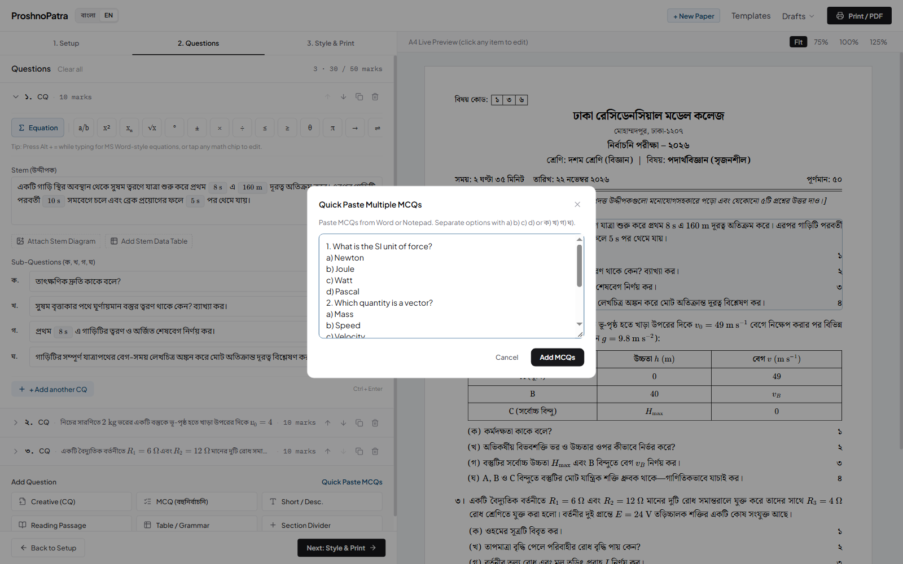
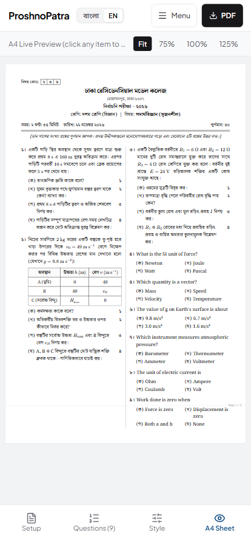
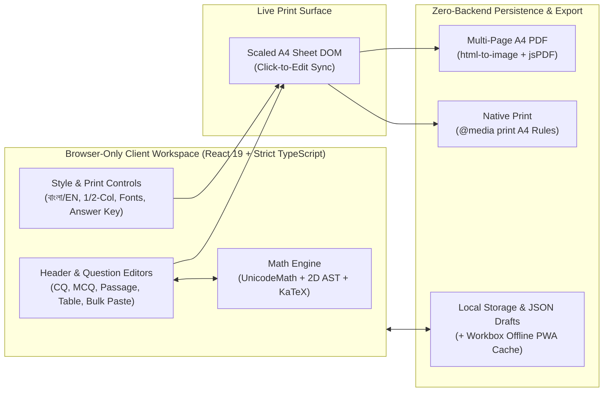

<div align="center">

<a href="https://aetheioai.github.io/ProshnoPatra-/">
  <picture>
    <source media="(prefers-color-scheme: dark)" srcset="docs/assets/banner-dark.svg" />
    <source media="(prefers-color-scheme: light)" srcset="docs/assets/banner-light.svg" />
    
  </picture>
</a>

<br />

<h3>ProshnoPatra &middot; প্রশ্নপত্র</h3>

<p>
  <b>Exam &amp; question paper studio for Bangladeshi schools, colleges, and board exams</b><br />
  <sub>বাংলাদেশের স্কুল, কলেজ ও বোর্ড পরীক্ষার A4 প্রশ্নপত্র তৈরির সম্পূর্ণ ফ্রি, অফলাইন ওপেন-সোর্স অ্যাপ</sub>
</p>

<p>
  <b>English</b> &nbsp;&bull;&nbsp; <a href="README.bn.md"><b>বাংলা সংস্করণ পড়ুন (README.bn.md)</b></a>
</p>

<p>
  <a href="https://aetheioai.github.io/ProshnoPatra-/"></a>
  <a href="README.bn.md"></a>
  <a href="CONTRIBUTING.md"></a>
</p>

<p>
  <a href="https://github.com/aetheioai/ProshnoPatra-/actions/workflows/ci.yml"></a>
  <a href="https://github.com/aetheioai/ProshnoPatra-/actions/workflows/deploy.yml"></a>
  <a href="LICENSE"></a>
  <a href="https://github.com/aetheioai/ProshnoPatra-/stargazers"></a>
  <a href="https://github.com/aetheioai/ProshnoPatra-/network/members"></a>
  <a href="https://github.com/aetheioai/ProshnoPatra-/issues"></a>
  <a href="#tech-stack"></a>
</p>

<p>
  <a href="#why-proshnopatra">Why ProshnoPatra</a> &nbsp;&middot;&nbsp;
  <a href="#feature-tour">Feature Tour</a> &nbsp;&middot;&nbsp;
  <a href="#word-style-equation-engine">Equation Engine</a> &nbsp;&middot;&nbsp;
  <a href="#nctb-curriculum--question-formats">Curriculum &amp; Formats</a> &nbsp;&middot;&nbsp;
  <a href="#keyboard-shortcuts">Shortcuts</a> &nbsp;&middot;&nbsp;
  <a href="#quick-start">Quick Start</a> &nbsp;&middot;&nbsp;
  <a href="#architecture--tech-stack">Architecture</a> &nbsp;&middot;&nbsp;
  <a href="#contributing">Contributing</a>
</p>

</div>

<br />

<p align="center">
  <a href="https://aetheioai.github.io/ProshnoPatra-/">
    
  </a>
  <br />
  <sub><b>Edit on the left, watch the print-ready A4 board sheet update live on the right.</b><br />No sign-up, no server round-trips, no broken Word margins — the sheet you see is the sheet you print.</sub>
</p>

> [!TIP]
> **Zero-friction for teachers:** Open **[aetheioai.github.io/ProshnoPatra-](https://aetheioai.github.io/ProshnoPatra-/)** in any modern browser, pick an NCTB preset, and start typing. After the first visit, the entire app installs as an **offline-first PWA** and keeps working even without internet access.

---

## Why ProshnoPatra?

Formatting Bangladeshi exam papers in general-purpose word processors means fighting column breaks, misaligned right-hand marks, broken Bangla numbering, and messy equations. **ProshnoPatra** is purpose-built around authentic Bangladeshi board typesetting from Class 1 to HSC.

<table>
  <tr>
    <td width="50%" valign="top">
      <h4>⚡ Zero Setup, Truly Offline</h4>
      Runs 100% in the browser as an installable PWA. No accounts, no backend servers, no API keys, and zero internet needed after the first load.
    </td>
    <td width="50%" valign="top">
      <h4>📄 Authentic NCTB Board Layout</h4>
      Built-in subject code boxes (<code>১|৩|৬</code>), set codes, institute logo, exam header, double hairline rules, and right-aligned per-part marks.
    </td>
  </tr>
  <tr>
    <td width="50%" valign="top">
      <h4>🌐 First-Class Bilingual (বাংলা &amp; EN)</h4>
      Switch the UI and paper independently between বাংলা and English — automatic numbering in <code>১, ২, ৩ / ক, খ, গ, ঘ</code> or <code>1, 2, 3 / a, b, c, d</code>.
    </td>
    <td width="50%" valign="top">
      <h4>∑ Word-Style Math Without LaTeX Pain</h4>
      Press <kbd>Alt</kbd>+<kbd>=</kbd> for inline UnicodeMath (<code>a/b</code>, <code>x^2</code>, <code>H_2O</code>) or use the visual AST Equation Builder with 155+ ready formulas and symbols.
    </td>
  </tr>
  <tr>
    <td width="50%" valign="top">
      <h4>🖨️ Print-Ready Multi-Page A4 PDF</h4>
      Export crisp multi-page A4 PDFs directly in the browser, or print straight from your college printer with dedicated <code>@media print</code> pagination rules.
    </td>
    <td width="50%" valign="top">
      <h4>🔒 Local-First Privacy</h4>
      Your papers, logos, diagrams, and drafts stay inside <code>localStorage</code> on your device. Export portable <code>.json</code> drafts anytime — zero tracking or uploads.
    </td>
  </tr>
</table>

---

## Feature Tour

ProshnoPatra follows a calm **3-step authoring flow** — **1. Setup** → **2. Questions** → **3. Style & Print** — synced live with a clickable A4 preview sheet. Click any question directly on the A4 page to jump straight to its editor.

### 1. Real Exam Question Editors & 2-Column Board Layouts

<table>
  <tr>
    <td width="50%" valign="top">
      <a href="docs/screenshots/02-questions.png">
        
      </a>
      <br />
      <b>Structured Question Authoring</b><br />
      Build Creative Questions (সৃজনশীল / CQ) with stems, attached diagrams, stem data tables, customizable <code>ক–ঘ</code> sub-questions, live marks tallying, and one-tap math chips. Press <kbd>Ctrl</kbd>/<kbd>⌘</kbd>+<kbd>Enter</kbd> to add the next question without lifting your hands.
    </td>
    <td width="50%" valign="top">
      <a href="docs/screenshots/06-mcq-layout.png">
        
      </a>
      <br />
      <b>Typography, Columns &amp; Answer Keys</b><br />
      Toggle 1-column written layout or classic 2-column board MCQ layout, switch between Serif (Board Classic) and Sans (Modern Clean), adjust font size and line spacing, and append an automatic <b>Teacher Answer Key Sheet</b> at the end.
    </td>
  </tr>
</table>

### 2. Visual Equation Builder & Bulk MCQ Importer

<table>
  <tr>
    <td width="50%" valign="top">
      <a href="docs/screenshots/03-equation-builder.png">
        
      </a>
      <br />
      <b>Two-Mode Visual Equation Builder</b><br />
      <b>Simple Mode</b> offers touch-friendly fill-in boxes (fractions, powers, roots, subscripts), a clean keypad, and categorized NCTB formulas (Physics, Chemistry, Biology, Algebra, Geometry &amp; Trig) that adapt to your selected subject. <b>Word / Pro Mode</b> unlocks the full 2D AST tree, matrices, piecewise cases, nuclear isotopes, and raw LaTeX.
    </td>
    <td width="50%" valign="top">
      <a href="docs/screenshots/04-quick-paste.png">
        
      </a>
      <br />
      <b>Quick Paste Bulk MCQs</b><br />
      Already drafted questions in MS Word, Google Docs, or Notepad? Paste an entire block of numbered questions with <code>a) b) c) d)</code> or <code>ক) খ) গ) ঘ)</code> options and convert them into structured, editable MCQs in a single click.
    </td>
  </tr>
</table>

### 3. Mobile-Ready & Classroom-Proof PWA

<table>
  <tr>
    <td width="34%" align="center" valign="middle">
      <a href="docs/screenshots/07-mobile.png">
        
      </a>
    </td>
    <td width="66%" valign="middle">
      <h4>Edit, Review &amp; Print From Your Phone</h4>
      <ul>
        <li><b>Dedicated Mobile Workspace:</b> Clean bottom navigation switches smoothly between <b>Setup</b>, <b>Questions</b>, <b>Style</b>, and a zoomable <b>A4 Sheet</b> preview (<code>Fit</code>, <code>75%</code>, <code>100%</code>, <code>125%</code>).</li>
        <li><b>Touch-Friendly Equation Keypad:</b> Write fractions, powers, chemical formulas, and Greek symbols comfortably on a phone screen without fighting mobile keyboards.</li>
        <li><b>Installable Offline PWA:</b> Powered by Workbox service worker caching — install directly to your Android, iOS, or desktop home screen and author papers in classrooms or staff rooms with zero signal.</li>
        <li><b>Portable JSON Drafts:</b> Export a paper as <code>.json</code> on your phone and import it on a school desktop later for printing.</li>
      </ul>
    </td>
  </tr>
</table>

---

## Word-Style Equation Engine

ProshnoPatra includes a custom **2D Mathematical AST** (`src/utils/mathAst.ts`) and **UnicodeMath Engine** (`src/utils/unicodeMath.ts`) backed by **KaTeX**, so teachers can write publication-grade math and chemistry without memorizing LaTeX syntax.

| Type inline (then press <kbd>Space</kbd>) | Rendered output | Use case |
| :--- | :--- | :--- |
| `a/b` or `(x+1)/(x-1)` | Stacked fraction | Algebra, Physics ratios |
| `x^2`, `v_0`, `m s^-2` | Superscript &amp; subscript | Kinematics, SI units |
| `H_2O`, `CO_2`, `H_2SO_4` | Chemical formulas | Chemistry stems &amp; MCQs |
| `\sqrt(b^2 - 4ac)` | Square root radical | Quadratic equations |
| `\theta`, `\pi`, `\Delta`, `\Omega` | $\theta, \pi, \Delta, \Omega$ | Trigonometry, Physics, Circuits |
| `->`, `<=>`, `>=`, `<=`, `+-` | $\rightarrow, \rightleftharpoons, \ge, \le, \pm$ | Chemical reactions &amp; inequalities |
| `$E = mc^2$` | Instant inline math chip | Raw LaTeX power users |

---

## NCTB Curriculum & Question Formats

ProshnoPatra ships with **20 pre-configured NCTB subjects** spanning **Primary (Class 1–5)**, **Junior (Class 6–8)**, **SSC (Class 9–10)**, **HSC (Class 11–12)**, and **Custom / Class Tests** — complete with automatic board subject codes and starter structures.

### Supported Question Blocks

| Block Type | Key Capabilities |
| :--- | :--- |
| **Creative Question (CQ / সৃজনশীল)** | Rich stem text, local image/diagram upload with resize &amp; alignment, stem data tables, customizable `ক–ঘ` sub-questions, per-part marks |
| **Multiple Choice (MCQ / বহুনির্বাচনি)** | 1- or 2-column layout, shared common stems, multi-statement (`i, ii, iii`) format, correct-answer marking for Teacher Answer Key |
| **Short &amp; Descriptive** | Standard written questions with optional `Or / অথবা` alternatives and right-aligned marks |
| **Reading Passage** | Comprehension passages paired with multi-part questions (ideal for English 1st Paper &amp; Bangla) |
| **Table / Grammar Grid** | Spreadsheet-style grid editor for accounting trial balances, Column A–B matching, substitution tables, and gap-fill with clues |
| **Section Divider** | Full-width section headers (`ক-বিভাগ`, `Part A: Reading Test`) with custom section instructions |

### Built-In Ready-to-Print Starter Templates

1. **SSC Physics (CQ · Bangla)** — Class 10, Code `136`, kinematics/circuits equations, stem data table &amp; `1–2–3–4` marks
2. **HSC Chemistry (2-Column MCQ · Bangla)** — Class 12, Code `176`, 2-column board layout, `i, ii, iii` multi-statement &amp; chemical equations
3. **SSC English 1st Paper (English)** — Class 9–10, Code `107`, reading passage, gap-filling with clues &amp; substitution table
4. **HSC Accounting (Trial Balance CQ · Bangla)** — Class 11–12, Code `253`, financial statement grid with right-aligned amounts
5. **Primary Class 5 (Math &amp; Matching · Bangla)** — Class 5, Column A–B matching table, arithmetic &amp; `অথবা` descriptive problems

---

## Keyboard Shortcuts

| Shortcut | Action |
| :--- | :--- |
| <kbd>Alt</kbd> + <kbd>=</kbd> | Open the inline Word-style equation pill at the cursor |
| <kbd>Space</kbd> *(inside prose field)* | Convert preceding linear math (`a/b`, `x^2`, `H_2`, `\theta`, `>=`) into a KaTeX chip |
| <kbd>Ctrl</kbd>/<kbd>⌘</kbd> + <kbd>=</kbd> | Toggle typeset preview inside the inline equation pill |
| <kbd>Ctrl</kbd>/<kbd>⌘</kbd> + <kbd>Shift</kbd> + <kbd>=</kbd> | Switch equation pill back to linear editing |
| <kbd>Enter</kbd> / <kbd>Esc</kbd> | Confirm &amp; insert / cancel the inline equation |
| <kbd>Ctrl</kbd>/<kbd>⌘</kbd> + <kbd>Enter</kbd> | Add another question of the same type and continue writing |
| <kbd>Ctrl</kbd>/<kbd>⌘</kbd> + <kbd>P</kbd> | Open native browser print dialog formatted for A4 paper |

---

## Quick Start

### Prerequisites

- **Node.js 20+** (Node 22 LTS recommended)
- **npm**, **bun**, or **pnpm**

### Run Locally

```bash
# 1. Clone the repository
git clone https://github.com/aetheioai/ProshnoPatra-.git
cd ProshnoPatra-

# 2. Install dependencies
npm install          # or: bun install

# 3. Start the local dev server
npm run dev          # opens at http://localhost:3000
```

No `.env` files, database setup, or API keys are required.

### Available Scripts

| Command | Description |
| :--- | :--- |
| `npm run dev` | Start Vite dev server on `http://localhost:3000` |
| `npm run build` | Build optimized production bundle &amp; PWA service worker into `dist/` |
| `npm run preview` | Preview the production build locally |
| `npm run typecheck` | Run strict TypeScript type-checking (`tsc --noEmit`) |
| `npm run clean` | Remove generated `dist/` and `dev-dist/` directories |

### Deployment

- **GitHub Pages (Pre-configured):** Pushing to `main` automatically runs typecheck, builds with `VITE_BASE_PATH`, generates `404.html` + `.nojekyll`, and deploys via [`.github/workflows/deploy.yml`](.github/workflows/deploy.yml). On a fork, enable **Settings → Pages → Source: GitHub Actions**.
- **Cloudflare Pages / Vercel / Netlify:** Run `npm run build` and publish `dist/` with zero extra config (`VITE_BASE_PATH` defaults to `/`).

---

## Architecture & Tech Stack



### Tech Stack

| Layer | Technology | Purpose |
| :--- | :--- | :--- |
| **Core UI** | React 19 + TypeScript (`strict`) | Component workspace &amp; type-safe paper schema |
| **Bundler** | Vite 8 | Fast HMR dev server &amp; lean production builds |
| **Styling** | Tailwind CSS v4 | Editorial UI styling &amp; A4 `@media print` stylesheet |
| **Math Typesetting** | KaTeX + Custom 2D AST / UnicodeMath | Print-sharp equations without LaTeX friction |
| **PDF Generation** | `html-to-image` + `jsPDF` | Client-side multi-page A4 PDF export |
| **Offline / PWA** | `vite-plugin-pwa` (Workbox) | Installable offline app with asset caching |
| **Icons** | `lucide-react` | Crisp vector UI iconography |

<details>
<summary><b>Explore full project structure</b></summary>

```text
ProshnoPatra-/
├── .github/
│   ├── ISSUE_TEMPLATE/              # Bug report & feature request templates
│   └── workflows/
│       ├── ci.yml                   # Typecheck & build check on push / PR
│       └── deploy.yml               # Automated GitHub Pages deployment
├── docs/
│   ├── assets/                      # Adaptive light/dark SVG banners
│   └── screenshots/                 # Product screenshots for docs
├── public/                          # App icon & PWA manifest icons
├── src/
│   ├── components/
│   │   ├── HeaderEditor.tsx         # Step 1: Institute, exam, NCTB subject & logo
│   │   ├── QuestionEditors.tsx      # Step 2: CQ, MCQ, Short, Passage, Table & Section editors
│   │   ├── StylePrintStep.tsx       # Step 3: Language, columns, typography & PDF/print
│   │   ├── PaperPreview.tsx         # Live scaled A4 sheet & print surface
│   │   ├── VisualMathModal.tsx      # 2D AST Equation Builder (Simple & Pro modes)
│   │   ├── VisualRichInput.tsx      # Prose editor with inline KaTeX chips & Word-style math
│   │   ├── InlineEquationPill.tsx   # Alt+= inline equation pill & quick snippets
│   │   ├── RichMathText.tsx         # Mixed prose + LaTeX renderer for A4 output
│   │   ├── TableGridEditor.tsx      # Spreadsheet-style table/grid editor
│   │   ├── ImageAttachmentControl.tsx # Local diagram upload, resize & alignment
│   │   ├── TemplateLibraryModal.tsx # Blank paper generator, presets & saved drafts
│   │   └── PWAInstallButton.tsx     # Install prompt & offline status indicator
│   ├── data/
│   │   ├── curriculum.ts            # 20 NCTB subjects (Class 1–HSC) & 5 starter presets
│   │   ├── mathLibrary.ts           # 155+ symbols & subject-grouped formula presets
│   │   └── uiCopy.ts                # Complete bilingual (বাংলা / English) interface copy
│   ├── hooks/
│   │   └── usePWAInstall.ts         # PWA install prompt & connectivity hooks
│   ├── types/
│   │   └── paper.ts                 # Core ExamPaper & QuestionItem TypeScript models
│   ├── utils/
│   │   ├── bulkMcqParser.ts         # Plain-text Bangla/English bulk MCQ parser
│   │   ├── formatters.ts            # Digit localization, marks math & JSON validation
│   │   ├── mathAst.ts               # Bidirectional LaTeX ⇄ 2D visual AST engine
│   │   ├── unicodeMath.ts           # MS Word-style UnicodeMath converter
│   │   └── pdfExport.ts             # Multi-page A4 PDF generator & print fallback
│   ├── App.tsx                      # Root workspace & localStorage persistence
│   ├── index.css                    # Tailwind theme, fonts & A4 print rules
│   └── main.tsx                     # App bootstrap & PWA service worker registration
├── README.md                        # English documentation
├── README.bn.md                     # বাংলা ডকুমেন্টেশন (Bangla documentation)
├── CONTRIBUTING.md                  # Contribution workflow & standards
├── CODE_OF_CONDUCT.md               # Community guidelines
├── SECURITY.md                      # Security reporting policy
└── LICENSE                          # MIT License
```

</details>

---

## Privacy & Offline Storage

> [!NOTE]
> **100% Client-Side by Design:** ProshnoPatra never transmits exam papers, institute logos, attached diagrams, or drafts to any external server. All autosave data and saved papers live locally in your browser's `localStorage`, and zero analytics or third-party tracking scripts are included.

---

## Contributing

Contributions from teachers, students, designers, and engineers are warmly welcomed! Whether you are fixing a subtle Bangla print-pagination quirk or adding new curriculum presets, every PR helps schools across Bangladesh.

### High-Impact Areas to Contribute

- **NCTB Curriculum &amp; Templates** (`src/data/curriculum.ts`) — Add Madrasah/Dakhil/Alim subjects, English Version presets, or new class templates.
- **Math &amp; Science Library** (`src/data/mathLibrary.ts`, `src/utils/mathAst.ts`) — Expand chemistry notation, higher math structures, or AST edge cases.
- **Print &amp; Board Typography** (`src/components/PaperPreview.tsx`, `src/index.css`) — Refine A4 page breaks, Bangla font metrics, and 2-column MCQ balancing.
- **Bilingual Copy &amp; Accessibility** (`src/data/uiCopy.ts`) — Polish Bangla phrasing, keyboard navigation, and mobile touch targets.

### Community & Governance

| Resource | Link |
| :--- | :--- |
| **Contribution Guide** | [CONTRIBUTING.md](CONTRIBUTING.md) |
| **Bug Reports** | [Open a Bug Report](https://github.com/aetheioai/ProshnoPatra-/issues/new?template=bug_report.md) |
| **Feature Requests** | [Suggest a Feature](https://github.com/aetheioai/ProshnoPatra-/issues/new?template=feature_request.md) |
| **Code of Conduct** | [CODE_OF_CONDUCT.md](CODE_OF_CONDUCT.md) |
| **Security Policy** | [SECURITY.md](SECURITY.md) |

---

## License

Released under the **[MIT License](LICENSE)** — free to use, modify, self-host, and share with your school, college, or coaching center.

<br />

<div align="center">

### Built for educators who would rather teach than fight Word margins.

If **ProshnoPatra** saved you an evening of exam formatting,<br />
⭐ **[Star the repository](https://github.com/aetheioai/ProshnoPatra-)** so more teachers and contributors can discover it!

<p>
  <a href="https://aetheioai.github.io/ProshnoPatra-/">Live App</a> &nbsp;&middot;&nbsp;
  <a href="README.bn.md">বাংলা সংস্করণ</a> &nbsp;&middot;&nbsp;
  <a href="CONTRIBUTING.md">Contribute</a> &nbsp;&middot;&nbsp;
  <a href="LICENSE">MIT License</a>
</p>

</div>
